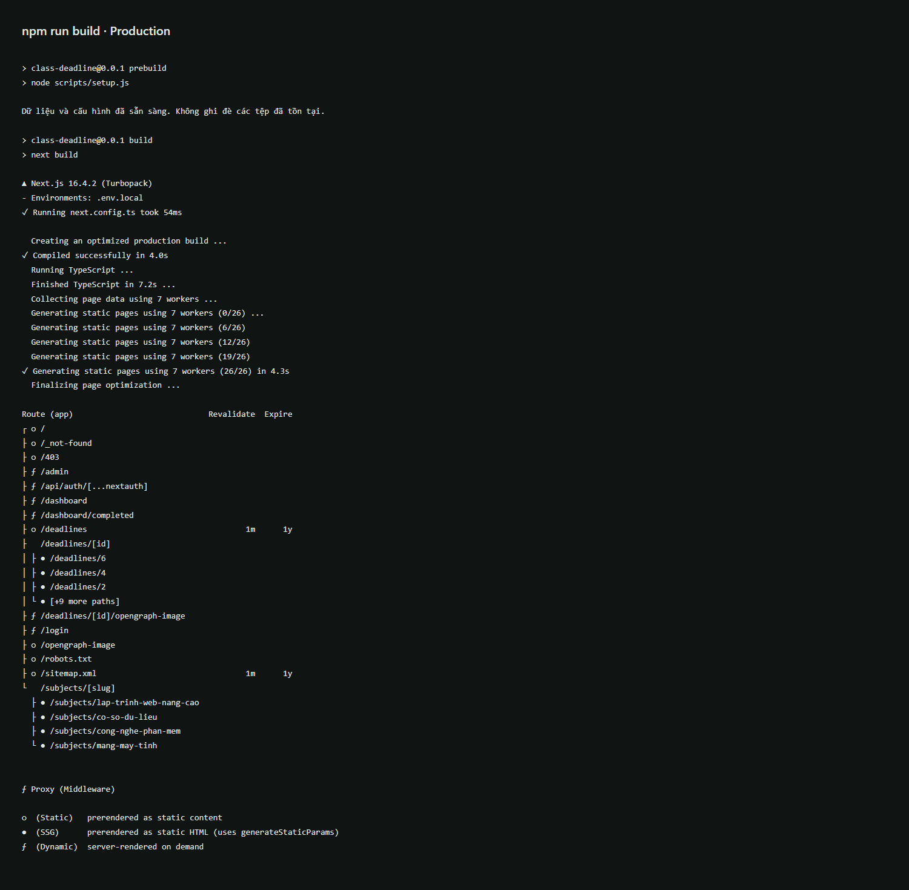
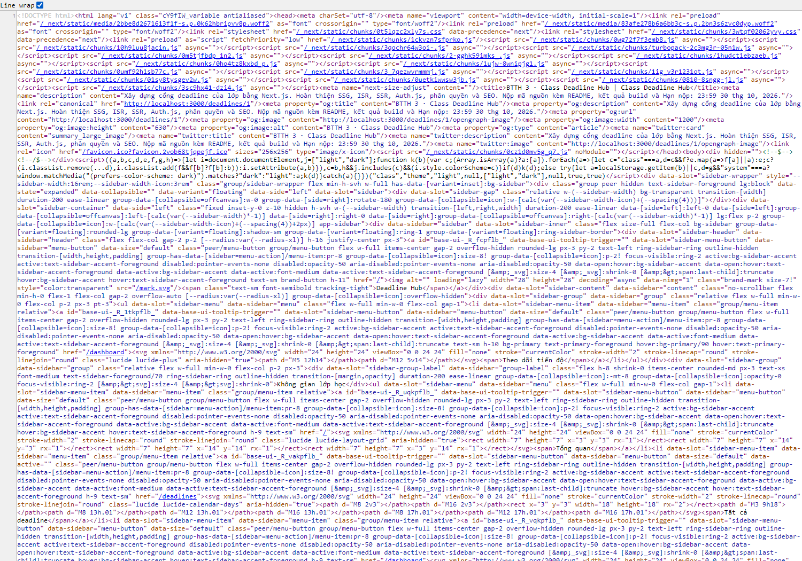

# Class Deadline

## Chạy dự án

Yêu cầu Node.js 22 trở lên, npm và quyền ghi vào thư mục `data/` khi chạy local. Bản Vercel dùng Private Blob để lưu JSON, không cần database.

```bash
npm ci
```

Nếu chưa có `.env.local`, sao chép `.env.example` thành `.env.local`. Sinh secret bằng lệnh dưới đây rồi điền kết quả vào `AUTH_SECRET` trong file vừa tạo:

```bash
node -e "console.log(require('node:crypto').randomBytes(32).toString('base64'))"
```

Nếu đã có `.env.local` hợp lệ thì giữ nguyên, không cần tạo lại secret. Khởi động ứng dụng:

```bash
npm run dev
```

Mở http://localhost:3000. Bộ dữ liệu thực hành và hai tài khoản đã có trong `data/subjects.json`, `data/store.json`, `data/users.json`; cần giữ các file này khi sao chép hoặc nộp dự án. Mật khẩu lưu dưới dạng hash scrypt với salt riêng. Khi không đặt token Blob, local đọc/ghi `data/store.json`. Khi có token, dữ liệu ghi vào Private Blob; nếu blob chưa tồn tại, ứng dụng tạo lần đầu từ `data/store.json` và không ghi đè blob đã có.

Chạy production (lệnh build dùng Webpack để tránh lỗi Turbopack đã gặp trên Windows):

```bash
npm run build
npm run start
```

Trước khi build với tên miền thật, chỉnh `SITE_URL` và `AUTH_URL` trong `.env.local`; giữ `AUTH_SECRET` ngẫu nhiên và ổn định. `.env.example` mô tả các biến cần thiết. `next/font/google` cần kết nối Internet trong lần build đầu.

| Email | Mật khẩu thực hành | Vai trò |
| --- | --- | --- |
| admin@ptit.edu.vn | admin123 | admin |
| sv@ptit.edu.vn | sv123456 | user |

Nhập tài khoản trực tiếp vào form đăng nhập. Dữ liệu tên môn, giảng viên và nội dung bài tập là dữ liệu thực hành; hạn nộp mẫu trải từ 23/10 đến 15/11/2026. Số lượng có thể thay đổi sau thao tác thêm/xóa.

Các biến môi trường được mô tả trong `.env.example`:

| Biến | Ý nghĩa |
| --- | --- |
| `AUTH_SECRET` | Secret dùng ký JWT; sinh ngẫu nhiên bằng lệnh Node.js ở trên. |
| `AUTH_URL` | Địa chỉ ứng dụng dùng cho xác thực, mặc định `http://localhost:3000`. |
| `SITE_URL` | Địa chỉ chuẩn để tạo canonical, sitemap và URL chia sẻ. |
| `AUTH_GITHUB_ID`, `AUTH_GITHUB_SECRET` | Client ID/Secret của GitHub OAuth App, tùy chọn. |
| `BLOB_READ_WRITE_TOKEN` | Token của **Private Blob Store**. Bắt buộc trên Vercel; để trống khi muốn local dùng file JSON. |
| `BLOB_STORE_PATH` | Đường dẫn JSON trong Blob, mặc định `class-deadline/store.json`. Dùng đường dẫn khác cho Preview để tách dữ liệu. |

Không đưa `.env.local` hoặc Client Secret vào Git. Khi tạo `.env.local` từ mẫu, phải thay `AUTH_SECRET` mẫu bằng secret ngẫu nhiên.

## Rendering và routing

| Route | Chiến lược | Lý do / cách triển khai |
| --- | --- | --- |
| `/` | SSG | `force-static`; tổng quan công khai được dựng sẵn. |
| `/subjects/[slug]` | SSG | `generateStaticParams()` cho 4 môn; slug ngoài danh sách trả 404. |
| `/deadlines` | ISR 60 giây | `revalidate = 60`; danh sách có thể cập nhật mà không build lại. |
| `/deadlines/[id]` | ISR theo yêu cầu | Dựng sẵn các ID ban đầu; ID mới sinh khi truy cập. `revalidatePath` vô hiệu hóa cache sau thêm/xóa. |
| `/dashboard` | SSR | Đọc session và trạng thái hoàn thành của đúng người dùng mỗi request. |
| `/dashboard/completed` | SSR | Cùng layout dashboard, chỉ hiển thị bài đã hoàn thành của tài khoản. |
| `/admin` | SSR | Kiểm tra quyền phía server trước khi hiển thị dữ liệu quản trị. |

Hai route group `(public)` và `(app)` có layout riêng. Dashboard giữ layout lồng nhau để bảo vệ truy cập; giao diện dùng toàn bộ chiều rộng, không còn sidebar phụ ghi tên tài khoản. Menu hiển thị trang đang chọn, có navigation mobile, skeleton riêng cho từng màn, error có nút “Thử lại” và trang 404 riêng.

Nội dung mặc định là Server Component. Client Components phục vụ tương tác: shell thu gọn, tài khoản, đếm ngược, lịch, lọc/tìm kiếm/sắp xếp, biểu mẫu và các nút thao tác. Danh sách truyền các dòng Server Component vào bộ lọc qua React nodes; nội dung có thể được render trong HTML ban đầu. Session của shell được lấy phía client để không biến các route SSG/ISR thành SSR. Nút hoàn thành trên trang chi tiết lấy tiến độ riêng qua `/api/deadlines/[id]/completion`, có kiểm tra session phía server và không cache dữ liệu cá nhân.

Thời gian đếm ngược cập nhật theo phút trên trình duyệt, các ngày giờ hiển thị theo UTC+7. Tab “Sắp đến hạn” là các bài chưa hoàn thành trong 7 ngày tới; bài đã hoàn thành không bị tính vào số quá hạn của tài khoản.

Ảnh kết quả build và log đầy đủ đã lưu từ phiên bản trước các thay đổi giao diện gần đây; chưa build lại bản hiện tại:



[Log npm run build](docs/evidence/build.txt)

## Xác thực và phân quyền

Auth.js Credentials sử dụng session JWT. `id` và `role` được đưa vào JWT/session, khai báo bằng module augmentation trong `types/next-auth.d.ts`. Role là union `guest | user | admin`; role của tài khoản đăng nhập chỉ là `user | admin`.

Ma trận quyền chỉ được định nghĩa tại `lib/permissions.ts`:

| Hành động | guest | user | admin |
| --- | --- | --- | --- |
| Xem deadline | Có | Có | Có |
| Đánh dấu hoàn thành | Không | Có | Có |
| Thêm deadline | Không | Không | Có |
| Xóa deadline | Không | Không | Có |

`proxy.ts` bảo vệ `/dashboard/:path*` và `/admin/:path*`: khách được chuyển tới `/login` kèm `callbackUrl`, user vào admin được chuyển tới `/403`. URL quay lại được kiểm tra để tránh open redirect. Next.js 16 đổi tên quy ước `middleware.ts` thành `proxy.ts`; đây là lớp middleware mà đề bài yêu cầu. Proxy đọc JWT mà không xoay cookie trên request prefetch, tránh request nền khôi phục cookie sau khi đăng xuất.

Trang admin và từng Server Action kiểm tra session/quyền riêng. Dữ liệu được kiểm tra độ dài, môn học tồn tại, ngày giờ có thật, mức ưu tiên và URL http/https. Người dùng không tự truyền được `userId` hay `role` để thay đổi tiến độ của người khác. Thao tác hoàn thành là đặt trạng thái rõ ràng, có thể hoàn tác và không tạo bản ghi trùng.

Ở local, JSON được ghi qua tệp tạm rồi rename, các cập nhật trong cùng tiến trình được xếp hàng. Với Private Blob, đọc dùng `useCache: false` để nhận bản mới nhất; ghi dùng ETag (`ifMatch`), đọc và thử lại tối đa 5 lần khi có cập nhật đồng thời. Không âm thầm ghi vào ổ đĩa nếu Vercel thiếu token hoặc Blob gặp lỗi. Xóa deadline đồng thời xóa các bản ghi hoàn thành liên quan. ID tăng đơn điệu, không tái sử dụng ID đã xóa. Các callback cập nhật chỉ thay đổi snapshot dữ liệu, để có thể chạy lại an toàn khi xung đột.

## Giao diện danh sách

Màn xem task chia 6:4 trên desktop: lịch tháng hiển thị công việc bên trái, danh sách và các tab lọc bên phải. Chọn ngày trên lịch để lọc danh sách; có chuyển tháng và trở về tháng hiện tại. Lịch/danh sách dùng chung bộ lọc, tìm kiếm và sắp xếp. Trên màn nhỏ, hai vùng xếp dọc. Bấm vào dòng task để xem chi tiết; tài khoản đăng nhập có thể hoàn thành/hoàn tác trực tiếp tại trang chi tiết và danh sách cá nhân.

Trong quản lý deadline, nút **Thêm mới** cạnh **Deadline đã đăng** mở Dialog chứa form. Bộ lọc và các trường lựa chọn dùng Select trong `components/ui`. Các trang chính có breadcrumb riêng; trang môn học hiển thị “Môn học > Tên môn”, chi tiết hiển thị “Tất cả deadline > Chi tiết deadline”.

Hồ sơ với avatar chữ cái đầu, tên, vai trò và đăng xuất ở footer sidebar; nút sáng/tối nằm trên header. Nhóm môn học trong sidebar chỉ hiện sau đăng nhập. Skeleton riêng của từng route theo bố cục tương ứng.

Sau lần rà soát và đổi tên Class Deadline, lint và 3 unit test đã qua; build production được kiểm tra lại. E2E và Lighthouse chưa chạy lại. Các ảnh minh chứng trong `docs/evidence/` thuộc phiên bản trước, có thể còn tên và giao diện cũ.

## Cache sau thay đổi

Thêm/xóa thành công sẽ vô hiệu hóa danh sách, chi tiết, sitemap và các trang tổng quan/môn học liên quan. Deadline mới truy cập được ngay; deadline đã xóa trả 404. Các trang static được tái tạo khi cần, không phải build lại toàn bộ ứng dụng.

ISR 60 giây không phải cron: sau khi quá 60 giây, request tiếp theo có thể nhận bản cache cũ trong lúc Next.js tái tạo nền. `revalidatePath` vô hiệu hóa cache ngay sau thao tác admin; việc tạo HTML mới diễn ra khi route được truy cập tiếp theo.

## SEO và ảnh chia sẻ

- Metadata động: tiêu đề, mô tả, canonical, Open Graph và Twitter cho từng deadline.
- `/deadlines/[id]/opengraph-image` tạo ảnh PNG riêng 1200×630 bằng `ImageResponse`, có tên bài, môn và hạn nộp. Font Be Vietnam Pro được lưu cục bộ kèm giấy phép OFL để hiển thị dấu tiếng Việt.
- `sitemap.xml` gồm các deadline hiện có và trang môn học; được làm mới khi thêm/xóa.
- `robots.txt` chặn dashboard/admin và API. Login, dashboard, admin có `noindex`; login không bị chặn crawl để crawler đọc được thẻ này.
- JSON-LD `BreadcrumbList` có trên trang chi tiết; chuỗi được escape trước khi đưa vào script.
- Dùng `next/font` cho Inter. Tiêu chí dùng `next/image` cần bổ sung: giao diện hiện chỉ dùng nhận diện bằng chữ, không render component ảnh.

Minh chứng HTML production của `/deadlines/1` đã lưu trước các thay đổi giao diện gần đây:



[HTML nguyên bản nhận từ server](docs/evidence/deadline-1-source.html)

## Kiểm thử và Lighthouse

```bash
npm run lint
npm run typecheck
npm test
# Chạy npm run start ở terminal khác trước các lệnh sau:
npm run test:e2e
# Đo lại Lighthouse bằng CLI khi cần:
npx lighthouse http://localhost:3000 --output=html --output-path=docs/evidence/lighthouse-home.html
npx lighthouse http://localhost:3000/deadlines/1 --output=html --output-path=docs/evidence/lighthouse-deadline-1.html
```

E2E dùng Playwright với Chrome đã cài. Có thể đổi `launchOptions.channel` trong `playwright.config.ts` hoặc cài Chromium của Playwright. E2E thay đổi dữ liệu mẫu: đánh dấu/hoàn tác và tạo/xóa bài tập có tiền tố `Bài tập E2E`; nên chạy trên bản dữ liệu thực hành.

`npm test` dùng **Node.js test runner (`node:test`)**, không phải Jest. File `tests/permissions.test.ts` có 3 bài test: toàn bộ 12 tổ hợp role/action của `can()`, URL quay lại và kiểm tra dữ liệu deadline. Điểm cộng **test Jest cho `can()` chưa hoàn thành**.

Mã E2E hiện có 5 kịch bản: HTML/SEO/404/ảnh chia sẻ, chuyển hướng guest và đăng nhập sai, tiến độ riêng của sinh viên, thêm/xóa và kiểm tra quyền admin/cache/sitemap, menu mobile/tablet. Log E2E cũ đã được dọn vì thuộc phiên bản Kanban trước đây. Chưa chạy lại E2E hoặc Lighthouse cho bản giao diện mới. Build local và typecheck được kiểm tra riêng khi tích hợp Blob; thao tác đọc/ghi trên dịch vụ Blob thật cần kiểm chứng sau khi cấu hình token.

Lighthouse đã được đo trên `next build` + `next start`, chế độ mobile mặc định có simulated throttling, Lighthouse 12.6.1. Thời điểm đo ghi trong `docs/evidence/lighthouse-scores.json`: **27/10/2026, khoảng 14:22 giờ Việt Nam**. Đây là kết quả phiên bản trước các thay đổi UI gần đây; chưa đo lại bản hiện tại. Điểm có thể thay đổi theo CPU, Chrome và điều kiện đo.

| Trang | Performance | Accessibility | Best practices | SEO |
| --- | ---: | ---: | ---: | ---: |
| `/` | 85 | 100 | 100 | 100 |
| `/deadlines/1` | 80 | 100 | 100 | 100 |

[Báo cáo trang chủ](docs/evidence/lighthouse-home.html) · [Báo cáo chi tiết](docs/evidence/lighthouse-deadline-1.html)

`docs/evidence/` chỉ giữ ảnh và log build, ảnh view-source kèm HTML nguồn, hai báo cáo Lighthouse HTML và bảng điểm kèm thời điểm đo. Ảnh giao diện/skeleton cũ, log E2E cũ và các bản Lighthouse JSON trùng nội dung báo cáo đã được dọn. Các script tạo minh chứng/đo điểm `.mjs` đã được xóa; cấu hình ESLint và PostCSS dùng `.js`. Các báo cáo Lighthouse là minh chứng tại thời điểm ghi trong báo cáo, không phải cam kết điểm cho mọi lần chạy.

## Trả lời câu hỏi

**Vì sao `/deadlines/[id]` dùng ISR?** Nội dung công khai được đọc nhiều và thay đổi ít. ISR giữ tốc độ phục vụ HTML dựng sẵn và khả năng đọc nội dung/metadata của crawler, đồng thời cho phép làm mới chi tiết khi admin thêm/xóa mà không build lại toàn bộ website. SSR mỗi request sẽ xử lý thừa; SSG chỉ lúc build có thể giữ dữ liệu đã bị xóa hoặc thiếu ID mới.

**Nếu chỉ dùng Middleware để bảo vệ `/admin` thì có rủi ro gì?** Middleware là lớp chặn request theo matcher, không thay thế việc kiểm tra quyền tại điểm đọc/ghi dữ liệu. Matcher có thể thiếu route, một điểm vào mới có thể gọi cùng thao tác, hoặc lỗi cấu hình có thể bỏ qua lớp chuyển hướng. Nếu Server Action tin dữ liệu từ client hoặc không kiểm tra session/quyền, người dùng có thể thử gọi thao tác quản trị trực tiếp. Vì vậy trang admin và mọi Server Action đều tự xác thực, gọi `can()` và kiểm tra đầu vào.

## Deploy lên Vercel với Private Blob

Ứng dụng lưu JSON trong **Private Blob**, không dùng database. `subjects.json` và `users.json` vẫn được đọc phía server từ mã nguồn; chỉ dữ liệu thay đổi trong `store.json` được lưu trên Blob. `next.config.ts` bảo đảm các file dữ liệu và font OG được đóng gói cùng server functions.

1. Đẩy mã nguồn lên GitHub, gồm `data/`, `assets/`, `package.json` và `package-lock.json`. Không đẩy `.env.local`, `node_modules/`, `.next/` hoặc token.
2. Trong Vercel, **Add New → Project**, import repository, chọn framework **Next.js**, Node.js **22.x**, Install Command `npm ci`, Build Command `npm run build` và Output Directory mặc định.
3. Tạo **Private Blob Store** tại mục **Storage** rồi kết nối với project. Bảo đảm biến `BLOB_READ_WRITE_TOKEN` được cấp cho môi trường Production. Nếu tạo token có tiền tố tên riêng, thêm biến đúng tên `BLOB_READ_WRITE_TOKEN` trỏ tới token đó.
4. Trong **Settings → Environment Variables**, đặt các biến dưới đây. Lấy tên miền production thực tế từ mục **Domains** của project.

   | Biến | Giá trị trên Vercel |
   | --- | --- |
   | `BLOB_READ_WRITE_TOKEN` | Token từ Private Blob Store vừa kết nối. |
   | `AUTH_SECRET` | Secret ngẫu nhiên sinh theo hướng dẫn chạy dự án; giữ ổn định giữa các lần deploy. |
   | `AUTH_URL` | `https://<tên-miền-production>` |
   | `SITE_URL` | `https://<tên-miền-production>` |
   | `BLOB_STORE_PATH` | `class-deadline/store.json`, có thể bỏ qua để dùng mặc định. |

5. **Deploy/Redeploy** sau khi cấu hình xong. Nếu lần deploy đầu chạy trước khi kết nối Blob, build sẽ báo thiếu token; cấu hình đủ rồi redeploy. Không cần tải `store.json` thủ công: khi blob chưa tồn tại, ứng dụng tạo từ dữ liệu kèm mã nguồn. Deploy lại sẽ tiếp tục đọc blob hiện có, không khôi phục đè dữ liệu từ Git.
6. Kiểm tra trên domain thật: đăng nhập admin, tạo một deadline, reload, xóa deadline; đăng nhập sinh viên, hoàn thành rồi reload và hoàn tác. Xác nhận file `class-deadline/store.json` xuất hiện trong Private Blob Store.

Với **Preview**, dùng Blob Store riêng hoặc đặt `BLOB_STORE_PATH=class-deadline/preview-store.json` trong phạm vi Preview để không thay đổi dữ liệu Production. Dùng `AUTH_URL` và `SITE_URL` phù hợp với URL của môi trường đang chạy.

Nếu muốn thử Blob ở local, điền token vào `.env.local` và đặt đường dẫn riêng như `BLOB_STORE_PATH=class-deadline/local-store.json`, rồi khởi động lại server. Khi token có mặt, local cũng dùng Blob, không ghi `data/store.json`.

### GitHub OAuth trên domain đã deploy

Tạo OAuth App tại GitHub → Settings → Developer settings → OAuth Apps. Đặt Homepage URL bằng domain production và Authorization callback URL bằng `https://<tên-miền-production>/api/auth/callback/github`. Thêm `AUTH_GITHUB_ID`, `AUTH_GITHUB_SECRET` vào biến môi trường Vercel rồi redeploy. Trang login tự hiện **Tiếp tục với GitHub** khi có đủ hai biến. Tài khoản GitHub nhận role `user`; dùng tài khoản Credentials mẫu để quản trị.

Tài liệu: [Private Blob](https://vercel.com/docs/vercel-blob/private-storage), [Blob SDK](https://vercel.com/docs/vercel-blob/using-blob-sdk), [GitHub OAuth với Auth.js](https://authjs.dev/guides/configuring-github).
